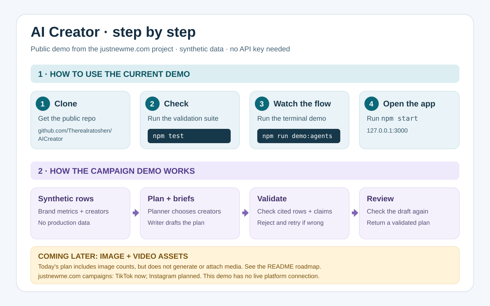

# AI Creator: public functionality from justnewme.com

This repository shares the **AI Creator and campaign planning functionality** developed as part of the [justnewme.com](https://justnewme.com) project. It is a standalone reference implementation and demo of the AI decision and validation layer. It is not the justnewme.com application, a deployment of its marketplace, or a connection to its production data.

The public code contains two related flows:

| Flow | What it does | Entry points |
| --- | --- | --- |
| Brand campaign copilot | Plans a week of creator campaigns, checks cited metric rows, and reviews briefs before returning a plan. | `src/agent/orchestrator.ts`, `scripts/demo-agents.ts`, `src/web/` |
| AI Creator | Explains a creator's own metrics or drafts a caption against their previous captions. It validates responses and rejects unsupported numbers. A voice memo can be transcribed before the same validation flow. | `src/agent/creator-agent.ts`, `src/agent/creator-answer.ts`, `src/agent/creator-no-fakes.ts`, `src/agent/voice.ts` |

The web app currently demonstrates the brand campaign flow. The creator flow is available as source and tests; it is not a separate web screen. The included brand and creator records are synthetic. No justnewme.com customer, creator, or production database records are required to run this repository.

**Platform availability:** justnewme.com currently supports **TikTok** as its live campaign channel. **Instagram support is on the roadmap.** This public AI demo does not connect to or publish on either platform.



The image shows the current brand campaign demo. The creator-side agent is available in source and tests; image and video generation are planned.

## Run locally

Node.js 22.6 or newer is required. There are no package dependencies or install step.

```bash
git clone https://github.com/Therealratoshen/AICreator.git
cd AICreator
npm test
npm run demo:agents
npm start
```

Open <http://127.0.0.1:3000> after `npm start`. Without `BASETEN_API_KEY`, the demos and web app use a scripted model and label that mode. The validation code still runs. To call the live model, set `BASETEN_API_KEY` in your environment before running a demo or the server. Keep the key out of files and commits.

`npm run demo` exercises the single agent campaign loop. `npm run cost` prints an illustrative estimate from the rates and token counts in `scripts/cost.ts`; it is not a measured bill or a pricing promise.

## How the functionality works

1. The brand flow receives metric rows and creator records. The public demo supplies synthetic records.
2. The planner chooses a week, posting cadence, creator shortlist, and campaign angle. The writer turns that strategy into a brief for each creator.
3. The model submits the plan through a tool. Application code checks its shape, cited row IDs, metric values, and claims in the copy. A rejected plan receives specific reasons for a retry.
4. The reviewer checks the accepted draft and can request revisions. If the retry budget is exhausted, the flow returns no plan.
5. The creator flow separately explains a creator's metrics or drafts a caption from their own past captions. Its responses pass their own validation and unsupported-number checks.

The current campaign plan is **text and structured data**: a weekly schedule, creator shortlist, and content briefs. A brief includes an `imageCount` field describing the intended number of images, but this repository does **not generate or attach image or video files**. See [Technique](docs/TECHNIQUE.md) and [Architecture](docs/ARCHITECTURE.md) for implementation details.

## Media roadmap

These are planned stages, not features available in the current demo. No release dates are committed.

1. **Image briefs:** expand each validated content brief with explicit visual direction and asset requirements, while preserving its creator and campaign references.
2. **Image generation:** generate candidate images from approved briefs, let a person review them, and attach selected assets to the plan with their source and approval status.
3. **Video briefs and drafts:** add a storyboard, shot list, timing, and caption or voiceover guidance for short videos, then generate or assemble draft video assets for review.
4. **Plan delivery:** expose approved image and video assets alongside the validated schedule and briefs when this module is connected to the justnewme.com product. Delivery and publication controls will be defined before that integration.

The plan's existing validation protects cited metrics and written claims. Media generation will need its own checks for asset provenance, usage rights, brand suitability, and human approval before any generated asset can be published.

## Platform roadmap

The live product supports TikTok campaigns today. Instagram campaign support is planned: connect authorized Instagram accounts, read permitted performance data, adapt briefs to Instagram formats, and validate the end-to-end publishing and reporting flow. This repository does not implement that platform connection, and no launch date is committed.

## Public sharing boundary

**Included:** the agent logic, validators, demo server, synthetic fixtures, tests, documentation, and example transcripts.

**Excluded:** the justnewme.com marketplace source, production integrations and credentials, private prompts or configuration, and real brand or creator data. The public demo does not read from justnewme.com's database or Instagram account. An application integrating these modules must supply its own authorized data and deployment controls.

Image and video generation, WhatsApp/Messenger delivery, and wiring into the live marketplace are outside this repository today. The voice transcription adapter is present, but a live call requires a separate API key and is not part of the default demo.

Before contributing, read [AGENTS.md](AGENTS.md) for the code invariants and [SECURITY.md](SECURITY.md) for safe reporting. Do not commit credentials, personal data, or production exports. Code is licensed under [Apache-2.0](LICENSE).
