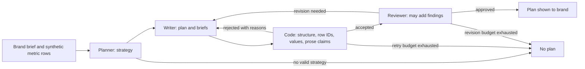

# AI Creator: guide for judges

## The idea in one minute

justnewme.com connects brands and creators for TikTok campaigns. This public repository isolates the AI planning and creator-assistance logic so it can be inspected and run without private marketplace data. The included records are synthetic. Instagram campaign support, generated images, and generated video are future work.

A brand asks for a campaign. Three agents propose a strategy, write briefs, and review the result. Code then checks that the plan has the required fields and that its numbers come from supplied data. A creator-side agent can explain a creator's own metrics or draft a caption based on previous captions. The creator flow is in source and tests; the web screen currently shows the brand flow.

**Key technical choice:** a fluent model answer is not treated as evidence. A plan is returned only after deterministic checks accept it. If the retry budget is exhausted, the run returns no plan.

The configured live model is **Meta's Muse Spark Open** (`meta-models/muse-spark-open`). The included live adapter uses Baseten's Model APIs, but Baseten is **optional for the local demo and tests**: without `BASETEN_API_KEY`, the repo uses a labelled scripted model. The same application validators run in both modes. The scripted mode verifies the workflow and rejection handling, not the quality of a live Muse Spark Open response.

## Five-minute walkthrough

1. Use Node.js 22.6 or newer. Run `npm test` at the repository root. The suite covers the real plan validator, agent loops, guards, web routes, and creator response logic with deterministic fixtures.
2. Run `npm run demo:agents`. Follow the planner → writer → reviewer transcript and the reasons for any rejected output. Without `BASETEN_API_KEY`, this uses a scripted model, clearly labelled as such.
3. Run `npm start`, then open `http://127.0.0.1:3000`. Submit a brief for a Monday and follow the progress stream to the final plan or failure. Runs live only in this process's memory and disappear on restart.
4. Inspect `src/agent/claims.ts` and `src/agent/no-fakes.ts`. They check numerical claims in prose and cited metric values against the rows supplied to the run.
5. Inspect `src/agent/creator-agent.ts` and `scripts/test-creator.ts` for the separate creator explanation and caption path. There is no creator web screen in this demo.

The [step-by-step image](images/ai-creator-step-by-step.svg) shows the brand demo. The [technical note](TECHNIQUE.md) gives the full validation rules and examples.

## What happens to a brand request

The model submits structured arguments through `submit_campaign_plan`. `validateCampaignPlan()` checks the shape and source row IDs. `checkNoFakes()` compares cited values with their rows. `claims.ts` scans prose for unsupported statistics and prohibited claim patterns. The reviewer cannot override a blocking code finding. The order is implemented in `src/agent/orchestrator.ts`.

For example, if a plan cites row `creator_1_views` as 4,900 views but the supplied row says 4,200, the value check rejects it. The model receives a field-specific reason and may retry. Passing the checks means the output is consistent with **supplied** rows; it does not independently verify where an integrator obtained those rows.

## Where to inspect the implementation

| Question | Source | Evidence |
| --- | --- | --- |
| What counts as a valid plan? | `src/agent/campaign-plan.ts` | `scripts/test-plan-validator.ts` |
| Can a cited number differ from its row? | `src/agent/no-fakes.ts` | `scripts/test-no-fakes.ts` |
| Can unsupported numbers appear in prose? | `src/agent/claims.ts` | `scripts/test-claims.ts` |
| Can a reviewer waive a code failure? | `src/agent/reviewer.ts` | `scripts/test-reviewer.ts` |
| What does the creator receive? | `src/agent/creator-agent.ts`, `src/agent/creator-answer.ts`, `src/agent/creator-no-fakes.ts` | `scripts/test-creator.ts` |
| What can a visitor actually run? | `src/web/server.ts`, `src/web/data.ts` | `scripts/test-web.ts` |

The web server exposes a page, a run creation endpoint, a run result endpoint, and a progress stream. It accepts a short brief and a Monday date, returns a run ID, and keeps the result in memory. `src/web/data.ts` supplies the synthetic rows. The optional live model call is configured with `BASETEN_API_KEY`; no key is needed for the scripted walkthrough.

## What the evidence means

`npm test` is a correctness check against local fixtures. It includes adversarial cases and real HTTP route tests, but it is not a production load test or a measurement of model quality across real campaigns. The committed transcripts are examples, not performance benchmarks. `npm run cost` computes an illustrative estimate from script inputs; it is not a bill.

This repository has **no signup system, user accounts, persistent storage, rate limiter, worker queue, TikTok or Instagram API connection, or deployment configuration**. It cannot establish whether 5,000 creators can register or use justnewme.com at once. Those questions belong to the marketplace repository and its Clerk, database, hosting, TikTok, and model-provider settings. Before connecting real data, the integrator must supply authentication, consent, access control, retention rules, provider limits, and a measured capacity test.

## Roadmap and present boundary

1. **Today:** synthetic-data brand demo; creator explanation and caption code with tests; TikTok campaigns in the separate live marketplace.
2. **Next:** image briefs, candidate image generation, provenance checks, and human approval.
3. **Later:** short-video storyboards and draft assets, with review before delivery.
4. **Platform integration:** connect approved assets and authorized data to justnewme.com; add Instagram support only after the permissions and end-to-end flow are ready.

No release date or production-scale claim is implied by this roadmap. See the [README](../README.md) for setup and the [security boundary](../SECURITY.md) before integrating real records.
